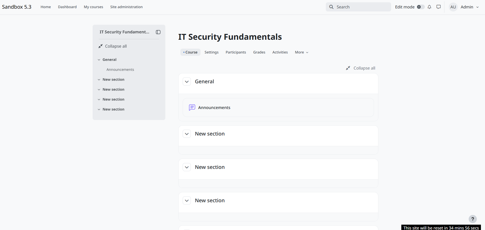
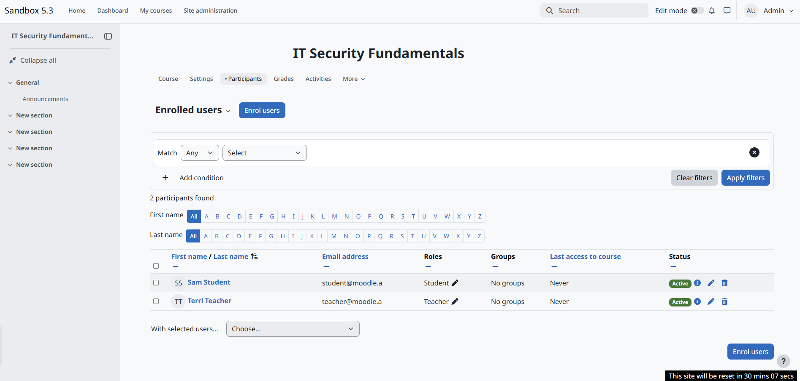
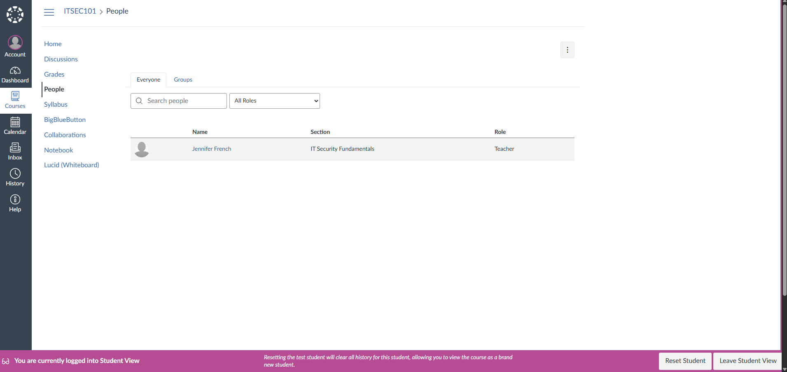
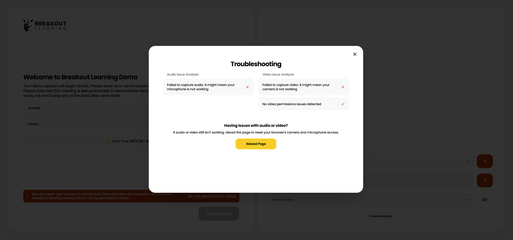

# LMS Administration & Integration Lab

## Overview

This project documents my hands-on exploration of Learning Management Systems (LMS), including course administration, role-based access control (RBAC), LTI 1.3 integrations, and platform troubleshooting.

I worked with Moodle 5.3, Canvas LMS, and Breakout Learning's demonstration platform. I also researched D2L Brightspace and Blackboard to better understand available administration and testing environments.

**Technologies:** Moodle 5.3, Canvas LMS, LTI 1.3, saLTIre, Breakout Learning

---

## 1. Moodle LMS — Course Administration

**Objective:** Create a course and configure user enrollment and access roles.

Using the Moodle 5.3 public sandbox, I created a course called **IT Security Fundamentals** (`ITSEC101`).

This provided a practice environment for exploring administrative features used in educational institutions.

### User Enrollment and Role-Based Access Control

I enrolled two demonstration accounts and assigned appropriate course-level roles:

- **Sam Student:** Student role
- **Terri Teacher:** Teacher role

Both accounts were successfully enrolled and displayed as active.

This exercise demonstrated how an LMS assigns distinct roles to users based on their responsibilities within a course.

## 2. Moodle — LTI 1.3 Integration

**Objective:** Explore secure integration between an LMS and an external learning application.

I configured **saLTIre**, an LTI testing tool, within the Moodle sandbox.

Configuration included:

- Selecting the LTI 1.3 protocol.
- Identifying the required initiation and redirection URLs.
- Configuring the RSA public keyset URL.
- Reviewing RS256 digital signature authentication.
- Saving the external tool configuration.

### Results

The external tool configuration was saved successfully.

However, Moodle's public sandbox resets every hour. The environment reset before I could launch the tool and verify the complete integration.

**Status:** Configuration completed; launch verification not performed due to sandbox expiration.

This exercise helped reinforce my understanding of how secure third-party learning tools connect to an LMS.

---

## 3. Canvas LMS — Course Administration and Student View

**Objective:** Explore Canvas course administration and student-level access.

Using a Canvas Evaluator account, I created and published a test course named **IT Security Fundamentals** (`ITSEC101`).

I examined the course navigation, enrollment interface, and available administrative features.

### Student View

I used Canvas's built-in **Student View** functionality to examine the course from a student's perspective without creating another account.

This feature is useful when troubleshooting differences between instructor and student access.

### LTI Access Limitations

I also investigated Canvas's external application settings.

The available integrations appeared restricted in the Evaluator environment, preventing completion of a hands-on LTI configuration.

**Status:** Course creation and Student View completed; LTI configuration unavailable in the account.

---

## 4. D2L Brightspace — Access Evaluation

**Objective:** Investigate available Brightspace demonstration and administrative environments.

I researched public demonstration options and attempted to access a student demo using publicly listed credentials.

The login attempt was unsuccessful.

I could not verify an accessible administrative sandbox without additional registration.

**Status:** Access evaluation completed; no hands-on configuration performed.

---

## 5. Blackboard LMS — Access Evaluation

**Objective:** Identify accessible Blackboard learning environments for administrative practice.

I reviewed available demonstration and trial options.

I could not verify unrestricted administrator access without additional registration or institutional credentials.

**Status:** Research completed; no hands-on configuration performed.

---

## 6. Breakout Learning — Platform Diagnostics

**Objective:** Explore the user experience and diagnostic tools of an AI-powered educational platform.

I accessed Breakout Learning's public demonstration environment and examined its pre-session device checks and troubleshooting features.

The platform identified:

- An unsuccessful microphone capture.
- An unsuccessful video capture.
- No detected camera permissions issue.
- A recommendation to reload the page to reset device access.

These diagnostics demonstrate how the platform identifies potential audio/video problems before a learning session begins.

I did not start a recorded discussion session.

---

## Key Takeaways

Through these exercises, I gained additional hands-on familiarity with:

- LMS course configuration and administration.
- Student and instructor role assignments.
- Course-level role-based access control.
- LTI 1.3 integration settings and authentication concepts.
- Viewing course access from a student's perspective.
- Educational platform diagnostic and support features.
- Identifying limitations in evaluation and sandbox environments.

## Conclusion

This project demonstrates my continued interest in educational technology, technical support, cloud-based applications, and secure platform integrations.

Building on my previous experience supporting and administering Moodle in a college environment, these labs allowed me to refresh existing knowledge, explore additional LMS platforms, and document practical technical work.
